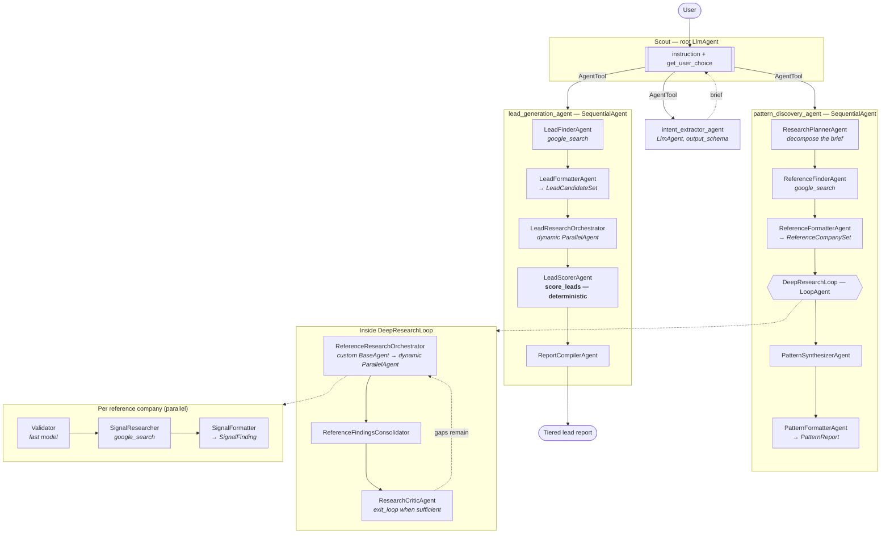

# (a) Deep Research Lead Generation Agent

A multi-agent system that does not guess at leads. It first studies companies
that **already** did the thing you want to predict, extracts the observable
signals that preceded the move, and only then goes looking for companies
showing those same signals today.

> Built with the [Google Agent Development Kit](https://google.github.io/adk-docs/).
> Inspired by [Build a deep research agent with Google ADK](https://cloud.google.com/blog/products/ai-machine-learning/build-a-deep-research-agent-with-google-adk)
> and [MagnIeeT/leadGenerationAgentADK](https://github.com/MagnIeeT/leadGenerationAgentADK).

---

## Why this shape

Most "lead gen agent" demos are a search tool with a nice prompt. They produce
a plausible list that nobody can defend in a pipeline review, because there is
no stated reason why *these* companies and not any others.

This agent inverts the problem into two research phases:

1. **Pattern discovery** — take companies that already entered the target
   market. Research the 12 months *before* each announcement. Distil the
   recurring, dated, checkable signals (a country-manager hire, a cluster of
   regional job reqs, a local trademark filing) and weight them by how many
   reference companies exhibited each one.
2. **Lead generation** — find companies that have *not* announced anything,
   check each one against those specific signals, and score the match.

The output is a tiered list where every row carries the patterns it matched and
the URLs backing them. That is a list you can take to a pipeline review.

## Architecture



### The ADK patterns on display

| Pattern | Where | Why here |
| --- | --- | --- |
| `LlmAgent` + `output_schema` | every formatter step | Schema-enforced hand-offs; the next agent gets a dict, not prose to re-parse |
| `SequentialAgent` | both phase pipelines | Fixed, auditable order of operations |
| `LoopAgent` + `exit_loop` | `DeepResearchLoop` | Research *depth*: the critic decides when the evidence is enough |
| `ParallelAgent` | inside both orchestrators | N companies researched concurrently instead of serially |
| Custom `BaseAgent` | `*Orchestrator` classes | Branch count is only known at runtime, after the finder returns |
| `AgentTool` | the three phases | Root keeps control of the conversation; plain `sub_agents` would hand it away |
| Function tool | `score_leads` | Arithmetic belongs in code, not in a prompt |
| `before_agent_callback` / `after_tool_callback` | `callbacks.py` | All state transitions in one reviewable place |
| Model routing | `config.py` | Flash for extract/format/validate, Pro for plan/research/synthesise |

### Why the searcher and the formatter are separate agents

A Gemini call cannot reliably use a built-in tool like `google_search` *and*
honour a strict `response_schema` at the same time. So every research step is a
pair: a reasoning-model agent that searches and writes prose, then a cheap
agent that converts that prose into the schema. It also happens to be the right
cost split — you pay reasoning prices only for reasoning.

### Why scoring is not done by the model

`tools/scoring.py` is a pure function. Given the same patterns and the same
evidence it returns the same score, every time:

```
fit_score = round(100 * matched_weight / total_weight) - disqualifier_penalty
tier      = A ≥ 80, B ≥ 60, C ≥ 40, else D
confidence= min(1, distinct_sources / 4), quartered if nothing matched
```

Three properties fall out of that, and all three are unit-tested:

- **Auditable.** "Why is this a tier A?" has an arithmetic answer.
- **Comparable.** Scores from Monday mean the same thing on Friday.
- **Hallucination-resistant.** A pattern name the researcher invented is not in
  the weight table, so it earns zero points.

## Quickstart

```bash
cd 01-lead-generation-deep-research
cp .env.example .env            # add your project, or an AI Studio key
make dev
make test                       # 59 offline tests, no credentials needed
make web                        # ADK dev UI at http://localhost:8000
```

Then try:

```
I sell cross-border payment rails. Find me fintech leads in Thailand.
```

Expect the agent to extract the brief, run pattern discovery, show you the
signals it found with evidence counts, **ask before** spending on lead
generation, and finally return a tiered report.

## Project layout

```
lead_generation_agent/
├── agent.py                     root agent (Scout) — the ADK entrypoint
├── config.py                    pydantic-settings, validated at import
├── constants.py                 StateKeys — every session-state key, in one place
├── prompts.py                   all prompts, reviewable independently of the graph
├── schemas.py                   the typed contracts between sub-agents
├── callbacks.py                 state seeding + promotion between phases
├── sub_agents/
│   ├── intent_extractor.py      phase 0: brief extraction
│   ├── pattern_discovery.py     phases 1-2: plan → search → loop → synthesise
│   ├── lead_generation.py       phase 3: find → verify → score → report
│   └── orchestrators.py         custom BaseAgents for dynamic parallel fan-out
└── tools/
    ├── agent_tools.py           the phases, wrapped as AgentTools
    └── scoring.py               deterministic lead scoring
```

## Configuration

Every knob is an environment variable, validated by `pydantic-settings` at
import time — a bad value fails fast at startup rather than mid-research.

| Variable | Default | Effect |
| --- | --- | --- |
| `GEN_FAST_MODEL` | `gemini-2.5-flash` | Extraction, formatting, validation |
| `GEN_ADVANCED_MODEL` | `gemini-2.5-pro` | Planning, research, synthesis |
| `DEFAULT_PATTERN_COMPANIES` | `5` | Reference companies studied (1-15) |
| `DEFAULT_LEAD_CANDIDATES` | `8` | Candidates qualified (1-25) |
| `MAX_RESEARCH_ITERATIONS` | `2` | Research critic loop passes (1-5) |
| `MIN_QUALIFIED_SCORE` | `55` | Bar for "qualified" (0-100) |

The two count knobs are the cost dials. `DEFAULT_PATTERN_COMPANIES=3` and
`DEFAULT_LEAD_CANDIDATES=5` makes a demo run cheap.

## Testing

```bash
make test
```

59 tests, all offline — no model, no network, no credentials:

- `test_scoring.py` — the scoring arithmetic, including the adversarial cases:
  hallucinated pattern names, duplicate sources, disqualifier capping, and
  determinism.
- `test_callbacks.py` — state transitions, including the backstop that refuses
  to leave the clarify stage while the brief is incomplete.
- `test_schemas.py` — contract validation and the bounded fields.
- `test_agent_wiring.py` — graph shape: pipeline order, scoring-before-report,
  the critic holding `exit_loop`, every `AgentTool` target having a description.

That last file is the one that earns its keep. Wiring bugs in a multi-agent
system do not crash — they quietly produce worse answers.

## Evaluation

```bash
make eval        # needs model credentials
```

Three eval sets covering the routing decisions that matter:

| Set | Asserts |
| --- | --- |
| `clarification.evalset.json` | Asks for missing fields; never invents a market; chit-chat does not trigger a pipeline |
| `pattern_discovery.evalset.json` | A complete brief runs discovery; an existing pattern set is not rediscovered |
| `lead_generation.evalset.json` | Confirmed generation produces a sourced report; "skip the analysis" is refused |

## Deployment

See [`deployment/README.md`](deployment/README.md) for Cloud Run and Vertex AI
Agent Engine, including the IAM roles and the sizing rationale.

## Known limits

- **Survivorship bias is structural.** Patterns come only from companies that
  *did* expand. We never see the ones that showed every signal and did nothing.
  The synthesizer is instructed to name this in its caveats; it does not fix it.
- **Grounding quality is search quality.** `google_search` surfaces what it
  surfaces. Thin coverage of a market yields thin patterns, which the critic
  loop will report as gaps rather than paper over.
- **Parallel fan-out is capped** at `MAX_PARALLEL_BRANCHES = 10` in
  `orchestrators.py`. Removing the cap will exhaust your model quota before it
  improves the research.
- **Freshness.** Signals decay. A trademark filing from two years ago is
  evidence of a decision already made, not a live opportunity. The prompts
  demand dates for exactly this reason, but nothing auto-expires a stale lead.
