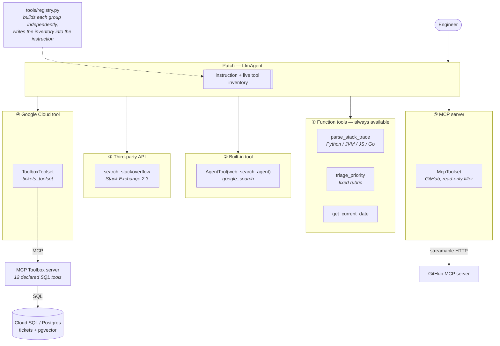

# (c) MCP Bug Assistant

An on-call engineering assistant that triages bug reports, finds known
duplicates, and manages tickets — built to demonstrate **every tool
integration path ADK offers**, converging on one agent.

> Built with the [Google Agent Development Kit](https://google.github.io/adk-docs/).
> Inspired by [Tools make an agent: from zero to assistant with ADK](https://cloud.google.com/blog/topics/developers-practitioners/tools-make-an-agent-from-zero-to-assistant-with-adk)
> and [google/adk-samples · software-bug-assistant](https://github.com/google/adk-samples).

---

## Five kinds of tool, one agent

| # | Tool kind | What it is here | Needs |
| --- | --- | --- | --- |
| 1 | **Function tools** | `parse_stack_trace`, `triage_priority`, `get_current_date` | nothing |
| 2 | **Built-in tool** | `google_search`, wrapped in an `AgentTool` | nothing |
| 3 | **Third-party API tool** | `search_stackoverflow` (Stack Exchange API) | optional key |
| 4 | **Google Cloud tool** | MCP Toolbox for Databases → Postgres/pgvector | Toolbox server |
| 5 | **MCP server tool** | GitHub MCP over streamable HTTP, read-only | a PAT |

Tools 3–5 are all optional, and **the agent starts without any of them**. That
is the production concern this build takes seriously; see below.

## Architecture



## What this build does differently

### 1. Graceful degradation, not silent failure

The reference sample builds every toolset at import, inside a bare
`try/except`:

```python
# Don't do this.
try:
    toolbox = ToolboxSyncClient(TOOLBOX_URL)
    toolbox_tools = toolbox.load_toolset("tickets_toolset")
except Exception:
    toolbox_tools = []          # agent now invents ticket data

mcp_tools = MCPToolset(headers={
    "Authorization": "Bearer " + os.getenv("GITHUB_PERSONAL_ACCESS_TOKEN"),
})                              # TypeError at import when the token is unset
```

Two failure modes fall out of that. A Toolbox server that is down becomes an
empty toolset, and an agent with no ticket tool will happily *make up* ticket
numbers. And a missing `GITHUB_PERSONAL_ACCESS_TOKEN` raises `TypeError` from
`"Bearer " + None` during import — a crash that looks like anything but a
configuration problem.

`tools/registry.py` builds each group independently and produces an
**inventory**, which is substituted into the agent's instruction at build time:

```
- **Diagnostics** (function tools): available - parse_stack_trace, triage_priority...
- **Ticket database** (MCP Toolbox): NOT available - could not be initialised: ...
- **GitHub** (MCP server): NOT available - GITHUB_PERSONAL_ACCESS_TOKEN is not set
- **Stack Overflow** (third-party API tool): available - anonymous, 300 requests/day
- **Google Search** (built-in tool): available

**You do not have: Ticket database, GitHub.** When a request needs one of
these, say which integration is missing and what would enable it. Never
substitute a guess for a tool you do not have.
```

Run `make inventory` to see yours. The agent then *says* "I cannot search
GitHub in this deployment" instead of fabricating an issue number.

### 2. Stack trace parsing that knows which end is which

`parse_stack_trace` handles Python, Java/Kotlin, JavaScript/TypeScript and Go,
and finds the **innermost first-party frame** — the last line of your code
before control passed into a library. Two things make that non-trivial:

**Trace ordering is language-specific.** Python puts the throwing frame *last*
("most recent call last"); JVM, JS and Go put it *first*. Get this backwards
and you report the HTTP entry point as the root cause of every bug — which
looks entirely plausible and is always wrong.

**Third-party detection is language-specific too.** A path check
(`site-packages`, `node_modules`) covers Python, JS and Go. JVM frames carry a
bare class filename like `Service.java` with no path at all, so there the
*package prefix* of the qualified method name is the only signal —
`org.springframework.` is library code, `com.example.` is yours.

The tool also emits a `suggested_search_query` with the volatile parts (hex
addresses, long IDs, absolute paths) stripped. A raw traceback is a terrible
search query; that cleaned string is a good one.

### 3. Triage by rubric, not by vibe

`triage_priority` scores a fixed table of impact signals:

| Signal | Points | Signal | Points |
| --- | --- | --- | --- |
| `data_loss` | 50 | `revenue_impact` | 15 |
| `security_impact` | 50 | `affects_many_users` | 10 |
| `production_outage` | 50 | `regression` | 10 |
| `no_workaround` | 20 | `blocks_release` | 10 |
| `affects_all_users` | 20 | `reproducible` | 5 |

≥70 → P0, ≥40 → P1, ≥15 → P2, else P3. Signal names the model invents score
zero and are reported as ignored. The rubric comes back in the tool result, so
the agent can show its arithmetic — and a reviewer can argue with the weights
instead of with the model.

### 4. Write restriction lives in the toolset, not the prompt

`tools.yaml` declares two toolsets. Point `MCP_TOOLBOX_TOOLSET` at
`tickets_readonly_toolset` and the four write tools **are not served at all**.
A prompt that says "do not write" is a suggestion; a toolset that omits the
write tools is a control.

Same reasoning behind `GITHUB_TOOL_FILTER`: an allowlist of eight read-only
tools. `test_github_filter_is_an_allowlist_without_write_tools` fails if a write
tool ever appears in the default.

And the agent cannot issue arbitrary SQL at all — only the 12 parameterised
statements in `tools.yaml`. No prompt injection reaches a `DROP TABLE`, because
no tool takes SQL as an argument.

## Quickstart

```bash
cd 03-mcp-bug-assistant
cp .env.example .env
make dev
make inventory        # see which tool groups are live
make test             # 73 offline tests, no services needed

# For the ticket tools:
make db-up            # Postgres + pgvector + Toolbox, via docker compose
make db-init          # schema + 10 seed tickets
make web              # http://localhost:8000
```

Then paste a stack trace:

```
Traceback (most recent call last):
  File "/app/svc/api/routes.py", line 88, in checkout
    totals = compute_totals(cart)
  File "/app/svc/pricing/aggregate.py", line 142, in compute_totals
    return sum(float(item["price"]) for item in items)
ValueError: could not convert string to float: 'N/A'
```

The seed data is built so this is a **duplicate of ticket 1**. A correct answer
names that ticket rather than offering to file a new one.

## Project layout

```
software_bug_assistant/
├── agent.py                 root agent; builds tool groups at import
├── config.py                every integration independently switchable
├── constants.py             priorities, statuses, state keys
├── prompts.py               instruction template with {tool_inventory}
└── tools/
    ├── registry.py          graceful degradation — read this one first
    ├── diagnostics.py       stack trace parsing + triage rubric
    └── stackoverflow.py     Stack Exchange API tool
data/
├── schema.sql               Cloud SQL / AlloyDB (with google_ml_integration)
├── schema_local.sql         plain Postgres + pgvector
└── seed.sql                 10 tickets, incl. a deliberate semantic duplicate
deployment/
├── mcp-toolbox/tools.yaml   12 SQL tools, 2 toolsets (full + read-only)
├── docker-compose.yaml      local Postgres + Toolbox
├── Dockerfile               Cloud Run image
└── cloudbuild.yaml          test → build → deploy
```

## Seed data, and why it looks like that

Ten tickets chosen to exercise the behaviours that matter:

- **#1 and #8 are the same bug worded completely differently.** Semantic search
  should find #1 when someone reports #8's symptoms. This is the test that
  separates a real duplicate check from a keyword match.
- **#2 is a third-party library bug.** The right answer is a web/GitHub search
  and an SDK upgrade, not a new ticket.
- **#4 is Resolved** with the fix described, so a fresh report should surface
  the resolution.
- **#6 is Blocked**, which is not In Progress. Conflating them tells someone
  work is happening when it is not.

## Testing

```bash
make test
```

73 tests, all offline — no database, no Toolbox server, no GitHub token, no
network:

- `test_diagnostics.py` — parsing across four languages, including the
  **ordering difference** (Python last vs JVM first), chained tracebacks,
  package-based JVM library detection, and prose correctly *rejected* as not a
  stack trace. Plus the rubric: determinism, normalisation of `"Data Loss"` →
  `data_loss`, invented signals scoring zero, and that every priority tier is
  reachable.
- `test_registry.py` — the degradation behaviour: no token means a *reported*
  absence, a builder that raises does not break startup, and the GitHub filter
  contains no write tools.
- `test_stackoverflow.py` — the API's real failure modes: quota exhaustion
  returned with HTTP 200, network timeouts, HTML entity decoding, and that an
  empty result reads differently from a failed search.
- `test_agent_wiring.py` — the instruction carries a substituted inventory, and
  the prompt's enum strings match the database `CHECK` constraints exactly.

## Evaluation

```bash
make eval
```

| Set | Asserts |
| --- | --- |
| `triage.evalset.json` | Parses before searching; recognises the #1/#8 semantic duplicate; sends third-party causes outward; triages by rubric; **asks** rather than assuming an impact signal |
| `ticket_management.evalset.json` | Confirms before creating; reads freely; does not invent ticket 9999; reports a missing integration; does not confuse Blocked with In Progress |

## Deployment

See [`deployment/README.md`](deployment/README.md) for Cloud SQL, the Toolbox
service, the agent, and the IAM each needs.

## Known limits

- **Embeddings are not auto-populated.** A ticket inserted outside the agent
  has a `NULL` embedding, and `search-tickets` filters those out, so it becomes
  invisible to semantic search. Re-run the `UPDATE` at the bottom of
  `seed.sql`, or add a trigger. `search-tickets-keyword` is the fallback, which
  is why both tools exist.
- **No local embedding function.** Plain Postgres has pgvector but not
  `google_ml_integration`, so local development is keyword-search only. The
  agent behaves identically; the duplicate detection is just less clever.
- **The Stack Exchange anonymous quota is 300 requests/day** per IP, shared
  across every user of a deployment. Set `STACKEXCHANGE_KEY` before anyone
  relies on it.
- **Triage weights are a starting point, not a law.** They encode one view of
  severity. Edit `TRIAGE_SIGNALS` to match your own policy — that is the
  advantage of a table over a prompt.
- **The agent has no memory across sessions.** It will re-triage the same report
  from scratch tomorrow. Wiring a `memory_service` is the next step if that
  matters.
