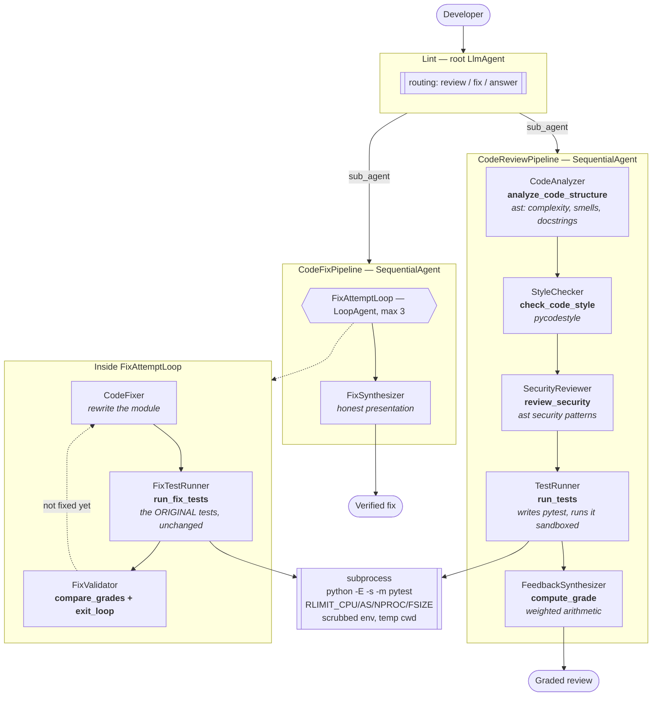

# (d) Code Review Assistant

A code reviewer that runs the same tools your CI runs, actually executes the
tests it writes, grades deterministically, and can fix what it found — then
proves the fix with the *original* tests.

> Built with the [Google Agent Development Kit](https://google.github.io/adk-docs/).
> Inspired by the [ADK Code Reviewer Assistant codelab](https://codelabs.developers.google.com/adk-code-reviewer-assistant/instructions)
> and [ayoisio/adk-code-review-assistant](https://github.com/ayoisio/adk-code-review-assistant).

---

## The idea

An LLM asked to "review this code" produces plausible prose. It will say the
function is too complex without knowing its complexity, claim the tests pass
without running them, and give a score it made up.

This agent splits the work by what each half is good at:

- **Tools establish facts.** `ast` counts the branches. `pycodestyle` finds the
  PEP 8 violations. A subprocess runs the tests. Arithmetic computes the grade.
- **Models do judgement.** What to test, which finding matters most, how to
  explain it so the author writes better code next time, and how to fix it.

Every number in the review traces back to a tool. Every explanation comes from
a model. Nothing is invented in between.

## Architecture



## What makes this production quality

### Deterministic grading, with two deliberate overrides

```
score = Σ (dimension_score × weight)      # correctness .40, security .25,
                                          # style .20, structure .15
```

Same submission, same score, every time — and "why is this a 62?" has an
answer you can check line by line. Two rules override the arithmetic:

| Override | Cap | Why |
| --- | --- | --- |
| Syntax error | **0** | There is nothing to grade, and guessing at problems past a parse failure wastes the author's time |
| Any critical security finding | **49** | A hardcoded credential must not be averaged away by tidy formatting and passing tests |

And a third rule that matters more than it looks: **an unassessed dimension is
not scored zero.** If code execution is disabled, correctness is reported as
"not assessed" and its weight is redistributed across the others. Scoring it
zero would punish the author for the deployment's configuration.

### The fix loop verifies with the original tests

`run_fix_tests` takes no test argument. It re-runs the tests the review phase
generated, unchanged, against the fixed code. That is the whole point: a fix
verified by new tests written to suit it proves nothing.

The `FixValidator` holds `exit_loop` and nothing else in the loop does, so the
loop can only end when the validator is satisfied. It is instructed to refuse
on a regression — a fix that breaks something that used to work does not ship,
however many other things it fixed — and to refuse to exit on an *unverified*
fix rather than assuming it is fine.

### Static analysis that knows what it is looking at

`analyze_code_structure` reports per-function cyclomatic complexity and finds:

| Detection | Why it is a real finding |
| --- | --- |
| Mutable default argument | Evaluated once at definition time; every call shares one object |
| Bare `except:` | Also catches `KeyboardInterrupt` and `SystemExit` |
| Swallowed exception | `except X: pass` makes the failure invisible |
| `is` against a literal | Identity, not value — works by interning accident until it does not |
| Excess complexity / length | Each branch is another path a test must cover |

Boolean operators count toward complexity, because `if a and b and c` is three
ways to fail, not one.

### Security checks tuned against false positives

`review_security` covers code execution, unsafe deserialisation, shell
injection, hardcoded credentials, SQL built by interpolation, disabled TLS
verification, weak hashes, and `assert` used for validation (`python -O` strips
asserts, so a security check written as one vanishes in an optimised build).

Roughly half the security tests assert a finding does **not** fire, because a
linter that cries wolf gets switched off:

- `yaml.load(x, Loader=yaml.SafeLoader)` — fine, not flagged.
- `hashlib.md5(x, usedforsecurity=False)` — an explicit opt-out, not flagged.
- `subprocess.run([...], shell=False)` — fine, not flagged.
- `API_KEY = "your-api-key"` / `"changeme"` / `"${API_KEY}"` — placeholders,
  not flagged. But `"sk-live-9f8e..."` is.
- `cursor.execute("... WHERE id = %s", (i,))` — parameterised, not flagged.

The tool also returns a `scope_note` saying these are syntax-level checks with
no dataflow analysis, and the prompts require passing it on. A clean scan is
not a security sign-off, and the author must not leave thinking it was one.

### Running model-written code against stranger-written code

This is the sharp edge of the whole agent, so it is worth being precise about.
`tools/execution.py` applies, in a child process:

- `python -E -s` and a throwaway working directory — no `PYTHONPATH` injection;
- `RLIMIT_CPU`, `RLIMIT_AS`, `RLIMIT_NPROC`, `RLIMIT_FSIZE`, `RLIMIT_CORE`;
- a wall-clock timeout with `setsid` + process-group kill;
- an environment scrubbed to `PATH`, `LANG`, `LC_ALL`.

Every one of those has a test, including one that asserts submitted code
**cannot read `GOOGLE_API_KEY`** out of the environment, and one that asserts a
process killed by `RLIMIT_CPU` is reported as `resource_limit` rather than
counted as a passing run.

And then the honest part: **this is defence in depth, not a sandbox.** There is
no network namespace, no filesystem namespace, no seccomp filter. The real
boundary is the deployment's — Cloud Run `--execution-environment=gen2`, which
is gVisor. `deployment/README.md` says so, the tool result says so in its
`isolation_note`, and `ENABLE_CODE_EXECUTION=false` turns the whole thing off
for deployments that cannot provide a sandbox.

## Quickstart

```bash
cd 04-code-review-assistant
cp .env.example .env
make dev
make sandbox      # prints the execution limits and the real boundary
make test         # 141 offline tests
make web          # http://localhost:8000
```

Paste something with a few problems in it:

```python
import subprocess

API_KEY = "sk-live-9f8e7d6c5b4a3210"

def process(items=[], cmd=None):
    try:
        subprocess.run("echo " + cmd, shell=True)
        return [i*2 for i in items]
    except:
        pass
```

Expect: a mutable default, a bare except, a swallowed exception, a hardcoded
credential, `shell=True`, no docstring — and a grade capped at 49 by the
critical finding, with the cap stated rather than hidden in an average.

## Project layout

```
code_review_assistant/
├── agent.py                    root agent (Lint)
├── config.py                   weights validated to sum to 1.0 at startup
├── constants.py                StateKeys for every pipeline hand-off
├── prompts.py                  all prompts
├── schemas.py                  typed shapes the tools return
├── sub_agents/
│   ├── review_pipeline.py      analyse → style → security → test → grade
│   └── fix_pipeline.py         LoopAgent(fix → verify → validate) + synthesiser
└── tools/
    ├── analysis.py             ast: structure, complexity, smells
    ├── style.py                pycodestyle
    ├── security.py             ast security patterns
    ├── execution.py            the sandboxed test runner — read this one
    └── grading.py              deterministic weighted grade
```

## Configuration

| Variable | Default | Effect |
| --- | --- | --- |
| `WORKER_MODEL` | `gemini-2.5-flash` | Structure, style, security stages |
| `CRITIC_MODEL` | `gemini-2.5-pro` | Test authoring, feedback, fixing, validation |
| `CORRECTNESS_WEIGHT` | `0.40` | Weight of the test results |
| `SECURITY_WEIGHT` | `0.25` | Weight of the security scan |
| `STYLE_WEIGHT` | `0.20` | Weight of PEP 8 compliance |
| `STRUCTURE_WEIGHT` | `0.15` | Weight of docs, complexity and smells |
| `PASSING_SCORE` | `70` | The pass mark |
| `MAX_COMPLEXITY` | `10` | Complexity above which a function is flagged |
| `ENABLE_CODE_EXECUTION` | `true` | Whether tests actually run |
| `EXECUTION_TIMEOUT_SECONDS` | `30` | Wall-clock ceiling per test run |
| `EXECUTION_CPU_SECONDS` | `20` | `RLIMIT_CPU` for the child |
| `EXECUTION_MEMORY_MB` | `512` | `RLIMIT_AS` for the child |
| `MAX_FIX_ATTEMPTS` | `3` | Fix loop iterations |

The weights are the policy knob — set them to what your team actually cares
about. They must sum to 1.0; `pydantic` rejects anything else at startup rather
than letting a typo quietly skew every score.

## Testing

```bash
make test
```

141 tests. The execution tests really do spawn subprocesses and really do hit
the resource limits — a control nobody tests is a control nobody has.

- `test_analysis.py` (23) — every detection, and the matching non-detection:
  `is None` is fine, `items=None` is fine, a logged exception is not
  "swallowed". Plus that a re-parse clears a stale syntax error, so a fixed
  submission is not still capped by a problem already resolved.
- `test_security.py` (45) — the true positives, and the false positives that
  must not fire. Includes that the credential value is never echoed back into
  the transcript.
- `test_execution.py` (22) — real subprocesses: an infinite loop killed by
  `RLIMIT_CPU` and classified as `resource_limit`, a sleeping process caught by
  the wall clock, a memory bomb that does not take the agent down, a broken
  test file distinguished from a failing test, and **submitted code unable to
  read the agent's credentials**.
- `test_grading.py` (25) — the arithmetic, both caps, and that an unassessed
  dimension redistributes its weight instead of scoring zero. Plus that bad
  weights fail fast.
- `test_agent_wiring.py` (26) — pipeline order, that **only** `FixValidator`
  holds `exit_loop`, that `FixTestRunner` holds `run_fix_tests` (so it cannot
  substitute new tests), and that each stage's prompt names the tool it holds.

## Evaluation

```bash
make eval
```

| Set | Asserts |
| --- | --- |
| `review.evalset.json` | Delegates to the pipeline; reports a syntax error and stops; states the critical-security cap as a cap; answers a question without running a pipeline; refuses to claim untested code works |
| `fix.evalset.json` | Fixes only after confirmation; reports an unverified fix **as unverified, first**; does not fix unasked |

## Deployment

See [`deployment/README.md`](deployment/README.md) — in particular the
isolation section, which is the part that decides whether this is safe to point
at code you did not write.

## Known limits

- **Python only.** The AST analysis, `pycodestyle` and the pytest runner are
  all Python-specific. Another language needs its own analysis module; the
  pipeline shape and the grading would carry over unchanged.
- **Generated tests test what the model understood.** They catch obvious
  breakage well and subtle logic errors poorly. The prompt insists on testing
  intended behaviour rather than observed behaviour, because a test asserting
  the current buggy output makes the bug permanent — but it is still a model
  reading intent from code.
- **The security scan has no dataflow analysis.** An injection reachable only
  through several function calls will not be found. The `scope_note` says so on
  every call; use Bandit or Semgrep alongside, not instead of your existing
  SAST.
- **Complexity is approximate.** It is a McCabe-style branch count, close
  enough to be useful and not identical to what `radon` or `mccabe` report.
- **One module at a time.** There is no cross-file analysis, so an import cycle
  or a bad interface between two modules is invisible.
